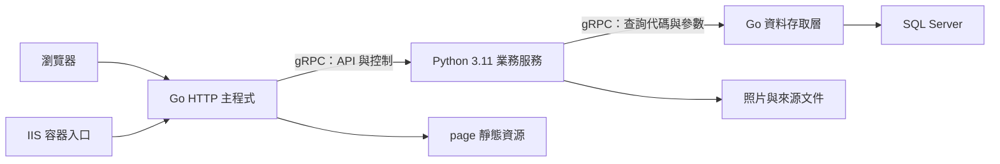

# 銀盾共同體營運中心

銀盾共同體營運中心整合企業官網、員工工作台與 MIS 後台，提供出勤管理、營運填報、教育訓練與企業宣導功能。前端使用原生 HTML、CSS 與 JavaScript，後端由 Go 提供 HTTP、程序管理與 SQL Server 存取，Python 3.11 透過私有 gRPC 執行既有業務邏輯，業務資料存放於 SQL Server。

目前提供 OMV／Linux systemd、Windows 本機執行與 Windows 容器部署方式。OMV 使用 `start.sh` 啟動 Go，並由 Go 管理 Python gRPC 工作程序，部署步驟請見 [OMV systemd 部署說明](backend/docs/omv-systemd.md)。Windows 容器以 Windows Server Core LTSC 2022 為基底，啟用內建 IIS，並在網站目錄建立 Python venv。

## 功能總覽

| 功能 | 說明 |
| --- | --- |
| 企業官網 | 企業資訊、四大產業據點、公開員工資料與部門篩選、合作資訊與地圖；後台可調整首頁文字、公告與四種視覺主題 |
| 員工入口 | 以有效員工編號登入，可選擇上班打卡或僅進入系統 |
| 工作台與出勤 | 伺服器校時、出勤狀態、上下班打卡與常用入口 |
| 員工管理 | 組織架構、員工搜尋與明細、員工照片、部門維護及打卡紀錄查詢 |
| 營運填報 | 日報提交、個人填報歷程、補件回覆，以及管理端核准、退回與要求補件 |
| 教育訓練 | 分類練習、模擬考、續作、逐題檢討、錯題本與術科申論 |
| 文件與題庫 | 來源文件同步與狀態維護、題目草稿審核、科目與章節維護、題目發布與停用 |
| 工作面板 | 分頁工具、Python 3.11 瀏覽器 Playground 與 Go WASM Playground |
| 企業宣導 | YouTube、BiliBili、ニコニコ、Douyin、TikTok 分頁播放與標題解析，以及 YouTube 縮圖下載 |
| MIS 後台 | 官網設定、資料表查閱、營運與申論審核、教育資料管理 |

學科題型包含單選、多選與閱讀；已移除程式碼填空與連連看設定，術科申論由管理員人工審核。模擬考交卷前不回傳正解與解析，作答紀錄保留題目快照。

## 前端介面與資源

前端採原生 HTML、共用 CSS 與 JavaScript ES Modules，不需要 Node.js 或前端打包工具。請透過 Go 或 IIS 提供的 HTTP 網址使用，讓模組載入、同來源 API 與工作階段驗證正常運作。

- 公開官網包含企業理念、四大產業據點、部門篩選名冊與合作資訊。據點圖片使用 `page/static/png/company/` 的相對路徑，可隨網站部署位址載入。
- MIS 官網設定提供銀盾藍（`shield`）、勳章紅（`medal`）、鋼鐵灰（`steel`）及專業白（`white`）四種主題，並提供首頁預覽。
- 七個內部頁面共用「工作台、營運日報、題庫練習、工作面板、宣導影音、員工管理、後台管理」側邊導覽。一般頁面側欄標示「內部使用」，員工管理與 MIS 則標示需管理員登入。
- 內部頁面統一內容寬度、卡片間距與表單樣式，透過 CSS 媒體查詢調整窄螢幕的導覽、欄位、員工清單與縮圖排列。
- 員工入口以醒目時鐘、員工編號及兩種進入方式呈現；題庫、員工管理、MIS、宣導影音與工作面板將分頁導覽置於頂部狀態列。

## 系統架構



唯一後端入口為 `backend/cmd/erp/main.go`；`database/data.go` 管理 SQL Server 連線池、參數化查詢與交易。SQL 本文集中於 Go 內嵌的查詢目錄，Python 不載入 SQL 驅動、不開 HTTP 服務。兩個內部 gRPC 端點僅綁定 `127.0.0.1` 的動態埠，並驗證每次啟動產生的權杖。Go 管理 Python 生命週期、請求期限與交易清理。

Python 保留輸入驗證、工作階段、CSRF、教育訓練、文件解析及影音解析。HTTP API 路徑與 JSON 契約沿用既有介面。Python 程序停止會使 Go 結束，由 systemd／Compose 重啟。工作階段仍在記憶體中，重啟後須重新登入。

## 專案結構

```text
erp_site/
├─ backend/                      # Go／Python 後端、gRPC、測試、部署及後端文件
│  ├─ cmd/erp/main.go            # Go 網站入口
│  ├─ internal/                  # 設定、HTTP 與程序管理
│  ├─ rpc/、proto/               # Go／Python 共用 gRPC 契約
│  ├─ src/erp/                   # Python 業務與文件解析
│  ├─ tests/                     # Python 單元測試
│  ├─ deploy/、docs/             # 部署範本與操作文件
│  └─ tools/generate_rpc.py      # gRPC 程式產生器
├─ page/                         # 官網、前後台頁面與靜態資源
│  └─ docs/、tools/              # 前端說明與瀏覽器 WASM 建置工具
├─ data/                         # 文件來源、原始檔與處理結果
├─ database/                     # Go 資料庫存取、SQL 查詢目錄、建表及初始資料
├─ agents/                       # 專案規範與依日期續寫的修改紀錄
├─ go.mod、go.sum                # Go 相依套件
├─ requirements*.txt             # Python 執行／開發相依套件
├─ start.bat、start.sh            # 執行預先編譯的 Go 主程式
└─ dockerfile、docker-compose.yml # Windows IIS 容器
```

資料庫實體表遵循 [DATABASE.md](agents/DATABASE.md)，既有 API 使用的 Company_* 名稱由相容檢視表提供。資料庫搬移、回復、盤點及演練工具已移除；建表與初始資料保留於 database/。

## 環境設定

目前主要資料庫為 Company，員工與部門由新資料表維護；初始資料為 22 位員工及 6 個部門，之後透過員工管理新增、修改及停用。

各種執行方式都需要可連線的 SQL Server，以及專案根目錄的 `.env`。設定欄位如下，請自行填入實際值：

| 欄位 | 用途 |
| --- | --- |
| `DatabaseIP` | SQL Server 位址；容器部署時須能從容器內連線 |
| `DatabasePort` | SQL Server TCP 連接埠 |
| `DatabaseName` | 使用的資料庫名稱 |
| `DatabaseUser` | 資料庫帳號 |
| `DatabasePassword` | 資料庫密碼 |
| `BackendWebAdminUser` | MIS 管理員帳號 |
| `BackendWebAdminPassword` | MIS 管理員密碼 |

資料庫與管理員設定由程式直接讀取 `.env` 檔案，僅設定同名的作業系統環境變數無法取代此檔案。程式未使用 `DatabaseDriver` 欄位，SQL Server 驅動由 `go.mod` 管理，無須 Python SQL／ODBC 套件。

一般啟動不執行 DDL；Go 以 database/SeedEmployees.sql 一次性建立員工及部門，重啟不覆寫後台維護內容。執行期不讀取 CSV。文件預設自動同步，可用 --skip-doc-sync 略過。全新資料庫可明確執行 --init-db，由 database/CreateTables.sql、SeedData.sql 及業務初始化建立必要資料；現有 Company 不需重新初始化。

## Windows 容器部署

### 執行需求

- 使用 Windows 容器模式的 Docker 與 Docker Compose。
- 可執行 Windows Server Core LTSC 2022 容器的主機環境。
- 可下載官方 image、Microsoft 安裝程式與 Python 套件的網路連線。
- 已完成上述 `.env` 設定，且容器可連線至 SQL Server。
- 主機的 80 埠可供網站使用。

### 建置與啟動

在專案根目錄執行：

```powershell
docker compose build erp_service
docker compose up -d
```

建置後的 image 名稱為 `erp-site:servercore-ltsc2022`，容器名稱為 `ERP_Site`。瀏覽 [網站首頁](http://localhost/) 或 [資料庫健康 API](http://localhost/api/health) 確認服務。

Dockerfile 先以 `golang:1.23-windowsservercore-ltsc2022` 編譯 Go，以官方 Python 3.11.9 安裝程式及 SHA-256 校驗安裝 Python，最終基底為 `mcr.microsoft.com/windows/servercore:ltsc2022`。建置流程包含 IIS、ARR、URL Rewrite、Visual C++ Runtime、venv 與 Python 套件安裝，並檢查 `start.bat --check`、文件套件匯入、產生的啟動腳本及 IIS XML。

容器啟動時，Go 使用 `127.0.0.1:8000`，IIS 使用 80 埠。啟動程序會監控 Go 與 IIS，任一停止便結束容器；Compose 設定為 `restart: unless-stopped`。

### 狀態與維護

```powershell
# 查看服務與健康狀態
docker compose ps

# 查看最近的啟動訊息
docker compose logs --tail 100 erp_service

# 持續追蹤記錄；Ctrl+C 結束追蹤
docker compose logs -f erp_service

# 停止服務並移除 Compose 容器與網路
docker compose down
```

目前 image 的健康檢查請求為首頁 `/`，用來確認 IIS 至 Go 的 HTTP 路徑（不涵蓋 Python／SQL 就緒狀態）；`/api/health` 另會讀取 SQL Server，供資料庫連線診斷。

### 目前部署行為

- 最終 image 保留必要 SQL／管理員設定，排除僅供部署使用的 DokerPublishName／DokerPublishPassword；本機 .env 不公開。Image 仍含執行所需帳密，不供公開分享。
- 網站程式與 `.env` 更新後，需要重新建置並更新容器，可執行 `docker compose up -d --build`。
- 尚未設定 volume。員工照片與文件快取等寫入容器的檔案，會在容器移除或重建時遺失；SQL Server 中的資料仍由資料庫保存。
- `.dockerignore` 排除 `data/` 內多數資料，容器不打包 `data/`，員工初始資料隨 `database/` 腳本部署，目前 image 不包含本機的 `data/exam/` 文件。
- 目前提供 HTTP，未設定 HTTPS。
- Image 未安裝 Tesseract、LibreOffice 或 Microsoft Word；需要 OCR 或舊版 DOC 轉檔時，須另外準備對應執行環境。

## Windows 本機執行

需要 Go 1.23+ 與 Python 3.11；啟動腳本不會自動下載套件或重新編譯。

```powershell
py -3.11 -m venv .venv
.\.venv\Scripts\python.exe -m pip install -r requirements.txt
go mod download
go build -trimpath -o bin/erp-site.exe ./backend/cmd/erp
.\start.bat --check
.\start.bat --host 127.0.0.1 --port 8080 --skip-doc-sync
```

`--check` 檢查 Python 版本與套件匯入，不連線資料庫。一般啟動必須先備妥既有或已初始化的 SQL Server。`start.bat` 預設使用 `0.0.0.0:80`，`start.sh` 預設使用 `0.0.0.0:8080`；命令列 `--host`／`--port` 優先於作業系統環境變數 `WEB_HOST`／`WEB_PORT`。`ERP_PYTHON` 或 `--python` 可指定 Python 3.11 的絕對路徑；這些啟動變數不從 `.env` 載入。

只有全新資料庫需要明確執行以下初始化；目前 Company 不需重新執行：

```powershell
.\start.bat --init-db
```

初始化遇到舊版實體表會拒絕執行，不會覆寫既有資料。

## 頁面與使用流程

| 頁面 | 使用方式 |
| --- | --- |
| `/`、`/index.html` | 公開企業官網 |
| `/employee-login.html` | 員工登入，選擇上班打卡或僅進入系統 |
| `/home.html` | 員工工作台、出勤狀態與常用入口 |
| `/sales.html` | 提交營運日報、查看審閱結果與回覆補件 |
| `/exam.html` | 學科刷題、模擬考、未完成題組續作、錯題本與術科申論 |
| `/workflow.html` | 工作面板、Python 3.11 與 Go 瀏覽器 Playground |
| `/game.html` | 五個影音平台分頁、影片標題、原站連結與 YouTube 縮圖下載 |
| `/staff.html` | 員工組織、明細、部門與打卡紀錄管理 |
| `/mis.html` | 官網設定、資料查閱、營運與教育訓練管理 |

員工先以在職員工編號登入，再進入工作台；管理功能還需通過 MIS 帳密驗證。HTML 頁面可被載入，資料讀取與寫入權限由各 API 在後端驗證。

上下班打卡依序交替，系統以 SQL Server 時間換算台灣工作日，並透過交易控制避免重複打卡。營運日報可由管理員要求補件、核准或退回，員工可查閱個人紀錄並回覆。

員工管理採組織架構、員工清單與員工明細三區介面，提供搜尋與停用員工篩選。員工照片支援 JPEG、PNG 與 WebP，單張上限為 5 MB。

工作面板可由側邊導覽及員工工作台的快捷入口開啟。包含 [Python Playground](page/docs/python-playground.md) 與 [Go Playground](page/docs/golang-playground.md)。兩者在瀏覽器執行，套件安裝／快取不會修改後端環境；Go WASM 工具與本次 Go 網站後端分開建置。

### 多平台宣導影音

在 `/game.html` 頂部分頁選擇平台，貼上對應網址並按「轉換並播放」。後端先驗證平台、網域與影片識別碼，再取得來源提供的標題並產生嵌入網址。

| 平台 | 可解析的影片格式 | 僅提供原站連結的格式 |
| --- | --- | --- |
| YouTube | 一般影片、直播、Shorts、分享短網址與嵌入網址 | 禁止嵌入的影片可改由「YouTube 開啟」觀看 |
| BiliBili | BV／av 影片與嵌入網址，保留 `p` 分集 | `b23.tv` 分享短網址、直播 |
| ニコニコ | 一般影片、`nico.ms` 影片短網址與嵌入網址 | 直播 |
| Douyin | 一般影片、`modal_id` 網址、分享影片與嵌入網址 | `v.douyin.com` 分享短網址、直播 |
| TikTok | 一般影片、分享影片與播放器／嵌入網址 | 分享短網址、直播 |

YouTube 使用 `/api/youtube/resolve` 與 oEmbed 取得影片資訊，前端設有 10 秒逾時。其他四個平台共用 `/api/media/resolve`，由 `backend/src/erp/media.py` 讀取固定來源的 API、XML 或嵌入頁面，前端設有 12 秒逾時。TikTok 優先讀取符合目前影片 ID 的說明，缺少資料時再嘗試 oEmbed，避免將其他影片或頁面標題當成影片標題。

兩個解析 API 都需要員工工作階段與 CSRF Token。各平台最近成功載入的網址分別保存在目前瀏覽器的 `localStorage`，不寫入 SQL Server。YouTube 進入頁面時會載入上次網址或預設影片；其他平台先還原輸入值，首次切換到該分頁時才嘗試載入既有紀錄。

僅提供原站連結時，不建立嵌入播放器，也不以影片 ID 代替標題。來源未填寫標題、無法取得標題與來源服務失敗會分別回報；成功取得標題仍可能因來源的登入、地區或嵌入限制而無法播放，可使用原站連結觀看。

### YouTube 縮圖

縮圖工具與播放器使用各自的輸入表單：

1. 貼上影片網址或 11 碼影片 ID，按「取得縮圖」。
2. 工具直接從 YouTube 圖片來源 `i.ytimg.com` 載入圖片，檢查實際尺寸並排除無效或逾時的縮圖。
3. 從可用的 HD（1280 × 720）、SD（640 × 480）、HQ（480 × 360）、MQ（320 × 180）尺寸中選擇下載；並非每部影片都有所有尺寸。
4. 瀏覽器無法直接下載時，介面會提供「開啟縮圖」連結，開啟後可另存圖片。

縮圖最近查詢最多保留 8 筆影片 ID，儲存在目前瀏覽器的 `localStorage`，可點選重新查詢或清除紀錄，不寫入 SQL Server。也可使用 `/game.html?url=影片網址或ID` 預填並啟動縮圖查詢；此參數只控制縮圖工具。

目前 `game.html` 的可見介面提供多平台影音與 YouTube 縮圖工具，未提供知識搜尋或 SOP 閱讀入口。後端仍保留文件查詢 API，來源文件管理與同步則位於 MIS。

## 影音解析 API

以下請求皆使用 JSON，並帶入員工工作階段 Cookie 與 `X-CSRF-Token` 標頭：

| 路徑 | 請求內容 | 成功回應 |
| --- | --- | --- |
| `POST /api/youtube/resolve` | `{"url":"YouTube 影片網址"}` | `data` 包含 `video_id`、`title`、`watch_url`、`embed_url` |
| `POST /api/media/resolve` | `{"platform":"bilibili","url":"對應平台影片網址"}` | `data` 包含 `platform`、`video_id`、`title`、`title_status`、`watch_url`、`embed_url` |

`platform` 支援 `bilibili`、`niconico`、`douyin`、`tiktok`。`title_status` 為 `available`（已取得標題）、`empty`（來源未填寫標題）或 `unavailable`（僅提供原站連結，此時 `embed_url` 為空字串）。無效輸入回傳 HTTP 400；來源資訊取得失敗回傳 HTTP 503 與 `EXTERNAL_SERVICE_UNAVAILABLE`。

## 文件與題庫同步

來源文件放在 `data/exam/`。支援 DOCX、舊版 DOC、Excel（含 XLSX、XLS）與 PDF；舊版 DOC 轉換結果快取在 `data/exam/.converted/`，保留原始文件。

| 文件類型 | 額外需求 |
| --- | --- |
| DOCX、Excel、可擷取文字的 PDF | 安裝 `requirements.txt` 中的套件 |
| 舊版 DOC | 優先使用 LibreOffice；Windows 本機可使用已安裝的 Microsoft Word COM 作為備援 |
| 掃描型 PDF | Tesseract OCR 與 `chi_tra`、`eng` 語言資料，搭配 PyMuPDF、Pillow、pytesseract |

Tesseract 可透過 PATH 或 `C:\Program Files\Tesseract-OCR\tesseract.exe` 尋找；LibreOffice 可透過 PATH 或 `C:\Program Files\LibreOffice\program\soffice.exe` 尋找。

解析文件並顯示摘要，不寫入資料庫；遇到舊版 DOC 時仍可能產生轉檔快取：

```powershell
.\.venv\Scripts\python.exe -m backend.src.erp.doc
```

將 SOP 同步至 SQL Server：

```powershell
.\start.bat --sync-docs
```

MIS 的來源同步功能會同步 SOP 與題庫草稿，並回報解析警告及失敗來源。管理員確認草稿後再發布題目，也可維護科目、章節、題目狀態與批次設定。

## 測試與檢查

Go 與 Python 測試分別位於 `backend/internal/`、`database/` 與 `backend/tests/test_*.py`，在專案根目錄執行：

```powershell
go test ./...
go vet ./...
.\.venv\Scripts\python.exe -m unittest discover -s backend/tests -p "test_*.py" -v
```

現有測試涵蓋題目解析、OCR 缺失回報、訓練輸入驗證、模擬考答案保護、CSRF 驗證、員工僅讀取資料庫，以及請求內資料庫連線重用。

影音測試另外涵蓋平台網址驗證、分集保留、來源標題解析、TikTok 影片對應與空白標題、僅原站連結、逾時、回應大小限制、禁止重新導向，以及 XML 實體拒絕處理。外部來源使用模擬回應，不代表第三方平台即時可用或影片可實際播放。

檢查 Python 套件與 Compose 設定：

```powershell
.\.venv\Scripts\python.exe -m pip check
docker compose config --quiet
```

## 權限與資料保護

- 員工與 MIS 使用各自的工作階段 Cookie，包含 HttpOnly、SameSite=Strict 與 8 小時有效期限。
- 受保護的資料異動 API 驗證登入身分與 CSRF Token，登入失敗也有次數限制。
- 工作階段存放在 Python 程序記憶體中，重新啟動後需重新登入。
- 後端驗證輸入、限制資料表與欄位存取，管理端資料表查閱會遮罩敏感欄位。
- 網頁與靜態資源採允許路徑及目錄邊界檢查，`.env` 與後端原始碼不透過網站提供下載。
- 多平台影音解析限制允許的網域、網址格式與固定查詢端點，拒絕含帳密或指定連接埠的輸入；`media.py` 禁止跟隨重新導向，單次回應上限為 2 MiB，並限制來源請求時間。
- 目前 SQL Server 連線字串使用 `Encrypt=no;TrustServerCertificate=yes`；網站 TLS 與資料庫加密需依部署需求另行設定。

## 常見問題

| 狀況 | 檢查方式 |
| --- | --- |
| 找不到 `.venv` 或缺少套件 | 重新執行本機環境安裝命令；確認從專案根目錄啟動 |
| 啟動失敗或容器反覆重新啟動 | 查看 `docker compose logs --tail 100 erp_service`，確認 Go 執行檔、Python 3.11、`.env` 與資料庫連線 |
| 網站開啟但 API 回應 503 | 使用 `/api/health` 檢查 SQL Server；確認執行環境可連線到設定的資料庫位址與連接埠 |
| 80 埠已被占用 | 本機改用 8080；容器部署則檢查主機既有服務與 Compose 的連接埠設定 |
| SOP 清單沒有來源文件 | 確認 `data/exam/` 中存在支援的檔案；目前 image 未打包該目錄 |
| 掃描 PDF 或舊版 DOC 無法解析 | 確認 Tesseract 語言資料或文件轉檔工具已安裝且可被程式找到 |
| 影音無法取得標題或回傳 503 | 確認員工登入、平台與網址是否相符，以及伺服器至來源平台的網路連線；來源拒絕存取時可稍後重試 |
| 影片有標題但無法播放，或只顯示原站連結 | 使用各平台的原站連結；短網址可改貼完整影片網址，並確認來源的登入、地區與嵌入限制 |
| Playground 無法載入 | 依 Python／Go Playground 文件確認瀏覽器執行環境與 WASM 資源 |
| YouTube 縮圖沒有部分尺寸或無法下載 | 僅顯示實際可用尺寸；確認可連線至 `i.ytimg.com`，直接下載失敗時使用「開啟縮圖」另存圖片 |
| 修改程式或 `.env` 後容器仍使用舊設定 | 重新建置 image 並更新容器 |

特別感謝 Codex、ChatGPT 與 Grok 在開發過程中提供協助。

## 開發與驗證範圍

修改 `.proto` 後，安裝 `requirements-dev.txt`、`protoc-gen-go@v1.36.5` 與 `protoc-gen-go-grpc@v1.5.1`，將 Go 工具目錄加入 PATH，再執行 `python backend/tools/generate_rpc.py`，同步提交兩種語言的產生檔。資料庫建表及 SQL 查詢目錄直接維護於 database/；本專案不再附帶資料庫搬移或演練工具。

一般單元測試使用模擬 SQL 與本機 gRPC，操作方式見 [Go 後端設計](backend/docs/go-backend.md)，歷史施作與未完成事項見 [history.md](agents/history.md)。
