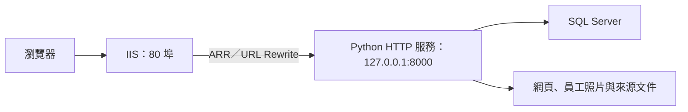

# 銀盾共同體營運中心

銀盾共同體營運中心整合企業官網、員工工作台與 MIS 後台，提供出勤管理、營運填報、教育訓練與企業宣導功能。前端使用原生 HTML、CSS 與 JavaScript，後端使用 Python HTTP 服務，業務資料存放於 SQL Server。

目前提供 Windows 本機執行與 Windows 容器部署兩種方式。容器以 Windows Server Core LTSC 2022 為基底，啟用內建 IIS，並在網站目錄建立 Python venv。

## 功能總覽

| 功能 | 說明 |
| --- | --- |
| 企業官網 | 企業資訊、產業據點、公開員工資料與部門篩選；後台可調整首頁文字與視覺主題 |
| 員工入口 | 以有效員工編號登入，可選擇上班打卡或僅進入系統 |
| 工作台與出勤 | 伺服器校時、出勤狀態、上下班打卡與常用入口 |
| 員工管理 | 組織架構、員工搜尋與明細、員工照片、部門維護及打卡紀錄查詢 |
| 營運填報 | 日報提交、個人填報歷程、補件回覆，以及管理端核准、退回與要求補件 |
| 教育訓練 | 分類練習、模擬考、續作、逐題檢討、錯題本與術科申論 |
| 文件與題庫 | SOP 查閱、來源文件同步、題目草稿審核、科目與章節維護、題目發布與停用 |
| 企業宣導 | YouTube 影音載入與標題解析、知識及 SOP 檢索 |
| MIS 後台 | 官網設定、資料表查閱、營運與申論審核、教育資料管理 |

學科題型包含單選、多選、閱讀、程式碼填空與配對；術科申論由管理員人工審核。模擬考交卷前不回傳正解與解析，作答紀錄保留題目快照。

## 系統架構



上圖為容器部署架構。IIS 將網站與 API 請求轉送給 `backend.app`，由 Python 處理頁面、靜態資源、權限及資料存取。網站部署於 `C:/inetpub/wwwroot/`，保留 `backend/`、`page/` 與 `data/` 的目錄結構。

本機執行時，`start.bat` 直接啟動 Python，使用 `0.0.0.0:80` 提供網站與 API。前端與後端使用同一來源，無須額外的前端建置流程。

## 專案結構

```text
erp_site/
├─ backend/
│  ├─ app.py                 # HTTP 路由、登入、工作階段與檔案回應
│  ├─ data.py                # SQL Server 查詢、交易、資料表初始化與資料維護
│  ├─ input.py               # 輸入驗證與資料清理
│  ├─ doc.py                 # 文件轉換、文字擷取、OCR 與來源同步
│  ├─ time_sync.py           # SQL Server 權威時間與台灣工作日換算
│  └─ test_training.py       # 題目解析、作答驗證、安全與資料庫連線回歸測試
├─ page/
│  ├─ *.html                 # 官網、員工頁面與後台
│  └─ static/                # 各頁 JavaScript、共用 CSS、圖片與員工照片
├─ data/
│  ├─ staff.csv              # 員工同步來源
│  ├─ Company_Schema.sql     # 資料表結構參考
│  └─ exam/                  # 自行準備的 SOP 與題庫來源文件
├─ templates/
│  └─ cookiecutter.json      # 專案範本參數
├─ dockerfile                # Windows image 建置與容器啟動設定
├─ docker-compose.yml        # 容器服務、image 名稱與連接埠設定
├─ requirements.txt          # 固定版本的 Python 直接相依套件
├─ start.bat                 # Windows 本機啟動與基本套件檢查
├─ .dockerignore             # Docker 建置內容排除規則
├─ .env                      # 自行準備的資料庫與管理員設定，不納入 Git
├─ CHANGELOG.md              # 版本變更紀錄
└─ Readme.md
```

`data/exam/` 與轉檔快取屬於執行環境資料，未隨 Git 提供。系統透過 `data.py` 初始化應用資料表；`Company_Schema.sql` 作為結構參考。

## 環境設定

兩種執行方式都需要可連線的 SQL Server，以及專案根目錄的 `.env`。設定欄位如下，請自行填入實際值：

| 欄位 | 用途 |
| --- | --- |
| `DatabaseIP` | SQL Server 位址；容器部署時須能從容器內連線 |
| `DatabasePort` | SQL Server TCP 連接埠 |
| `DatabaseName` | 使用的資料庫名稱 |
| `DatabaseUser` | 資料庫帳號 |
| `DatabasePassword` | 資料庫密碼 |
| `BackendWebAdminUser` | MIS 管理員帳號 |
| `BackendWebAdminPassword` | MIS 管理員密碼 |

資料庫與管理員設定由程式直接讀取 `.env` 檔案，僅設定同名的作業系統環境變數無法取代此檔案。程式未使用 `DatabaseDriver` 欄位，SQL Server 存取套件由 `requirements.txt` 安裝。

啟動時會執行應用資料表初始化與結構更新，因此資料庫帳號須具備相應的建表、結構更新及業務資料讀寫權限。完成初始化後，程式預設同步 `data/exam/` 內的 SOP 文件；文件同步失敗會記錄訊息，資料庫初始化失敗則會中止啟動。

## Windows 容器部署

### 執行需求

- 使用 Windows 容器模式的 Docker 與 Docker Compose。
- 可執行 Windows Server Core LTSC 2022 容器的主機環境。
- 可下載官方 image、Microsoft 安裝程式與 Python 套件的網路連線。
- 已完成上述 `.env` 設定，且容器可連線至 SQL Server。
- 主機的 80 埠可供網站使用。

### 建置與啟動

在專案根目錄執行：

```powershell
docker compose build erp_service
docker compose up -d
```

建置後的 image 名稱為 `erp-site:servercore-ltsc2022`，容器名稱為 `ERP_Site`。瀏覽 [網站首頁](http://localhost/) 或 [資料庫健康 API](http://localhost/api/health) 確認服務。

Dockerfile 從官方 `python:3.13-windowsservercore-ltsc2022` image 取得 Python，最終基底為 `mcr.microsoft.com/windows/servercore:ltsc2022`。建置流程包含 IIS、ARR、URL Rewrite、Visual C++ Runtime、venv 與 Python 套件安裝，並檢查 `start.bat --check`、文件套件匯入、產生的啟動腳本及 IIS XML。

容器啟動時，Python 使用 `127.0.0.1:8000`，IIS 使用 80 埠。啟動程序會監控 Python 與 IIS，任一停止便結束容器；Compose 設定為 `restart: unless-stopped`。

### 狀態與維護

```powershell
# 查看服務與健康狀態
docker compose ps

# 查看最近的啟動訊息
docker compose logs --tail 100 erp_service

# 持續追蹤記錄；Ctrl+C 結束追蹤
docker compose logs -f erp_service

# 停止服務並移除 Compose 容器與網路
docker compose down
```

目前 image 的健康檢查請求為首頁 `/`，用來確認 IIS 至 Python 的 HTTP 路徑；`/api/health` 另會讀取 SQL Server，供資料庫連線診斷。

### 目前部署行為

- `.env` 會被複製進 image，因此 image 含有部署環境的機密設定；分享或發布 image 前需先處理其中的帳密。
- 網站程式與 `.env` 更新後，需要重新建置並更新容器，可執行 `docker compose up -d --build`。
- 尚未設定 volume。員工照片與文件快取等寫入容器的檔案，會在容器移除或重建時遺失；SQL Server 中的資料仍由資料庫保存。
- `.dockerignore` 排除 `data/` 內多數資料，Dockerfile 只複製 `staff.csv` 與 `Company_Schema.sql`，目前 image 不包含本機的 `data/exam/` 文件。
- 目前提供 HTTP，未設定 HTTPS。
- Image 未安裝 Tesseract、LibreOffice 或 Microsoft Word；需要 OCR 或舊版 DOC 轉檔時，須另外準備對應執行環境。

## Windows 本機執行

容器使用 Python 3.13。本機可使用 Python 3.13 建立專案虛擬環境，再安裝相同相依套件：

```powershell
python -m venv .venv
.\.venv\Scripts\python.exe -m pip install -r requirements.txt
.\start.bat --check
.\start.bat
```

`start.bat --check` 只檢查 venv 與基本套件匯入，不測試 SQL Server 連線。`start.bat` 固定使用 80 埠；若發生連接埠占用或權限錯誤，可改用以下開發命令：

```powershell
.\.venv\Scripts\python.exe -m backend.app --host 127.0.0.1 --port 8080
```

啟動後開啟 [本機網站](http://127.0.0.1:8080/) 或 [資料庫健康 API](http://127.0.0.1:8080/api/health)。略過啟動時的 SOP 文件同步：

```powershell
.\.venv\Scripts\python.exe -m backend.app --host 127.0.0.1 --port 8080 --skip-doc-sync
```

直接執行 `backend.app` 時，也可用作業系統環境變數 `SILVER_SHIELD_HOST`、`SILVER_SHIELD_PORT` 設定預設監聽位址與連接埠。命令列參數優先；`start.bat` 與容器啟動程序已有明確指定值。這兩個變數不會從專案 `.env` 自動載入。

## 頁面與使用流程

| 頁面 | 使用方式 |
| --- | --- |
| `/`、`/index.html` | 公開企業官網 |
| `/employee-login.html` | 員工登入，選擇上班打卡或僅進入系統 |
| `/home.html` | 員工工作台、出勤狀態與常用入口 |
| `/sales.html` | 提交營運日報、查看審閱結果與回覆補件 |
| `/exam.html` | 練習、模擬考、錯題本與術科作答 |
| `/game.html` | 企業宣導影音、知識與 SOP 查閱 |
| `/staff.html` | 員工組織、明細、部門與打卡紀錄管理 |
| `/mis.html` | 官網設定、資料查閱、營運與教育訓練管理 |

員工先以在職員工編號登入，再進入工作台；管理功能還需通過 MIS 帳密驗證。HTML 頁面可被載入，資料讀取與寫入權限由各 API 在後端驗證。

上下班打卡依序交替，系統以 SQL Server 時間換算台灣工作日，並透過交易控制避免重複打卡。營運日報可由管理員要求補件、核准或退回，員工可查閱個人紀錄並回覆。

員工管理採組織架構、員工清單與員工明細三區介面，提供搜尋與停用員工篩選。員工照片支援 JPEG、PNG 與 WebP，單張上限為 5 MB。

## 文件與題庫同步

來源文件放在 `data/exam/`。支援 DOCX、舊版 DOC、Excel（含 XLSX、XLS）與 PDF；舊版 DOC 轉換結果快取在 `data/exam/.converted/`，保留原始文件。

| 文件類型 | 額外需求 |
| --- | --- |
| DOCX、Excel、可擷取文字的 PDF | 安裝 `requirements.txt` 中的套件 |
| 舊版 DOC | 優先使用 LibreOffice；Windows 本機可使用已安裝的 Microsoft Word COM 作為備援 |
| 掃描型 PDF | Tesseract OCR 與 `chi_tra`、`eng` 語言資料，搭配 PyMuPDF、Pillow、pytesseract |

Tesseract 可透過 PATH 或 `C:\Program Files\Tesseract-OCR\tesseract.exe` 尋找；LibreOffice 可透過 PATH 或 `C:\Program Files\LibreOffice\program\soffice.exe` 尋找。

解析文件並顯示摘要，不寫入資料庫；遇到舊版 DOC 時仍可能產生轉檔快取：

```powershell
.\.venv\Scripts\python.exe -m backend.doc
```

將 SOP 同步至 SQL Server：

```powershell
.\.venv\Scripts\python.exe -m backend.doc --sync
```

MIS 的來源同步功能會同步 SOP 與題庫草稿，並回報解析警告及失敗來源。管理員確認草稿後再發布題目，也可維護科目、章節、題目狀態與批次設定。

## 測試與檢查

測試檔案位於 `backend/test_training.py`，在專案根目錄執行：

```powershell
.\.venv\Scripts\python.exe -m unittest backend.test_training -v
```

現有測試涵蓋題目解析、OCR 缺失回報、訓練輸入驗證、模擬考答案保護、CSRF 驗證、員工同步快取，以及請求內資料庫連線重用。

檢查 Python 套件與 Compose 設定：

```powershell
.\.venv\Scripts\python.exe -m pip check
docker compose config --quiet
```

## 權限與資料保護

- 員工與 MIS 使用各自的工作階段 Cookie，包含 HttpOnly、SameSite=Strict 與 8 小時有效期限。
- 受保護的資料異動 API 驗證登入身分與 CSRF Token，登入失敗也有次數限制。
- 工作階段存放在 Python 程序記憶體中，重新啟動後需重新登入。
- 後端驗證輸入、限制資料表與欄位存取，管理端資料表查閱會遮罩敏感欄位。
- 網頁與靜態資源採允許路徑及目錄邊界檢查，`.env` 與後端原始碼不透過網站提供下載。
- 目前 SQL Server 連線字串使用 `Encrypt=no;TrustServerCertificate=yes`；網站 TLS 與資料庫加密需依部署需求另行設定。

## 常見問題

| 狀況 | 檢查方式 |
| --- | --- |
| 找不到 `.venv` 或缺少套件 | 重新執行本機環境安裝命令；確認從專案根目錄啟動 |
| 啟動失敗或容器反覆重新啟動 | 查看 `docker compose logs --tail 100 erp_service`，確認 `.env`、資料庫連線及初始化權限 |
| 網站開啟但 API 回應 503 | 使用 `/api/health` 檢查 SQL Server；確認執行環境可連線到設定的資料庫位址與連接埠 |
| 80 埠已被占用 | 本機改用 8080；容器部署則檢查主機既有服務與 Compose 的連接埠設定 |
| SOP 清單沒有來源文件 | 確認 `data/exam/` 中存在支援的檔案；目前 image 未打包該目錄 |
| 掃描 PDF 或舊版 DOC 無法解析 | 確認 Tesseract 語言資料或文件轉檔工具已安裝且可被程式找到 |
| 修改程式或 `.env` 後容器仍使用舊設定 | 重新建置 image 並更新容器 |

特別感謝 Codex、ChatGPT 與 Grok 在開發過程中提供協助。
