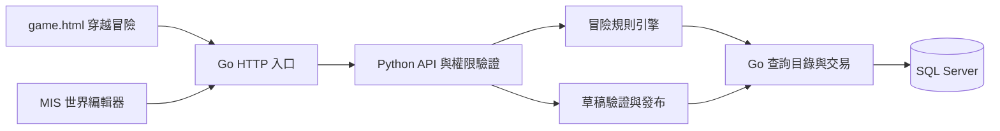
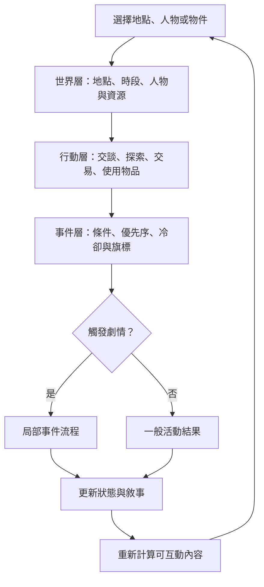
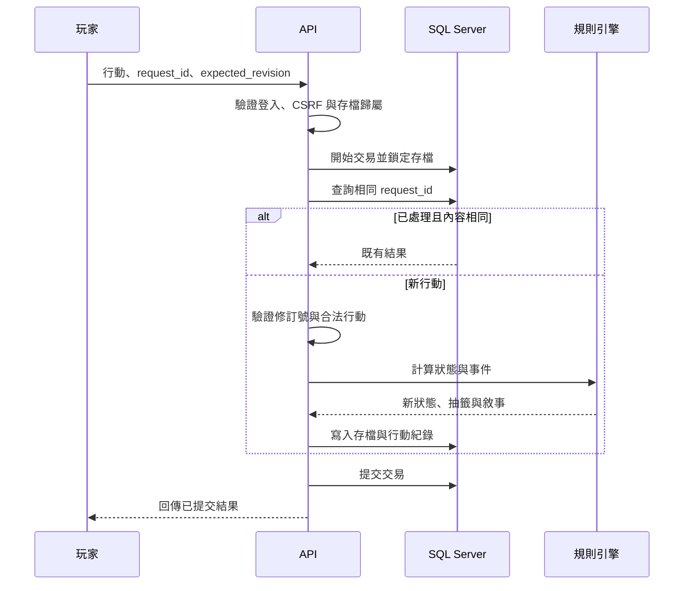
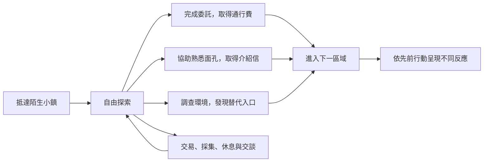

# 員工穿越冒險 RPG：現況、設計與維護交接

更新日期：2026-11-07

需求提出者：Phoenix

適用對象：Antigravity 與後續維護者

## 1. 目前範圍與閱讀方式

最新優先順序是「網站恢復可用、員工能登入、RPG 基本流程能用」。完整產品規劃仍保留，但不作為本輪已完成的宣告，也不要求為補齊進階功能再次擴大修復範圍。

| 項目 | 最近一次修復後的狀態 |
|---|---|
| 網站及員工登入 | 已修復內網 HTTP Cookie 問題；實際登入、session 及登出驗證通過 |
| 資料庫 | 使用既有 Company；未切換或重建已刪除的無關資料庫 |
| RPG 基本功能 | 前後台、引擎及存檔已有實作；主要缺陷已修正並有回歸測試 |
| 作者工具 | 已接上表單、連線、儲存、試跑與發布相關實作；完整實機操作待驗收 |
| 資料表規範 | 建表檔改為拒絕 NULL；既有資料庫尚未套用強化 DDL |
| 完整驗收 | 真實瀏覽器端到端遊玩、SQL Server 並行寫入尚未完成 |
| 後續擴充 | 通用事件排程、進階作者體驗、完整技能模板與示範章節驗收保留待辦 |

閱讀順序：第 2 節為修復及驗證；第 3～11 節為完整產品設計與驗收目標；第 12～13 節為維護交接與待辦。

本次僅重整文件，未重新啟動網站、執行程式測試或修改資料庫。以下結果引用 2026-11-07 修復紀錄，不代表本次重新驗證，也不保證服務此刻仍在運行。

## 2. 最近一次修復與驗證結果

原始檢查提出 R01～R14，以下保留編號並合併修復結果，不再把已修復項目並列為現行待修清單。歷史時序見 [history.md](history.md) 的 2026-11-07 紀錄。

### 網站與資料庫

- `.env` 仍指向 `10.10.0.4:1433 / Company`，最後修改時間為 2026-10-30；未改動連線值，也未重建已刪除的其他資料庫。已唯讀確認實際 Company 的員工檢視表及五張 RPG 表欄位，查詢以這些欄位為準。
- 實際員工登入失效原因已重現：舊程序以 `--tls-proxy` 提供內網 HTTP，登入回應 200 但 Secure Cookie 無法保存，下一次 session 查詢為未登入。新增明確 `--allow-lan-http` 模式，驗證直接來源為私有／回送 IP，且不信任偽造的轉送標頭；HTTPS／真正代理部署仍強制 Secure Cookie。
- `start.bat` 改用內網 HTTP 模式並保留 `0.0.0.0:80`。登入後允許返回 game／workflow；登入成功後校時失敗不再誤報登入失敗。
- 修復本機 `.venv` 指向不存在的 Python 3.11 來源路徑，改用專案內 `.deps/python-runtime/` 的 Python 3.11.9；保留既有套件。此 runtime 已是本機執行相依，不是待刪臨時檔。
- Go 已重新編譯，舊網站程序已重新啟動；啟動紀錄列出實際設定路徑與資料庫目標，不包含帳密。

### RPG 修復對照

| 追蹤編號與原問題 | 修復結果與限制 |
|---|---|
| R01、R02：偽造流程與非法行動 | 統一依伺服器可用行動解析對象、條件、成本與出口；拒絕跳點、遠端交談、隱藏活動、對話中移動與不合法物品操作。 |
| R03、R05：管理端 CSRF 與作者介面缺漏 | 管理端寫入取得管理員 CSRF；編輯器初始化一次，接上世界建立／切換、型別化資源／節點表單、連線與欄位回寫。進階作者與實機操作驗收仍待後續。 |
| R04、R06：第二份存檔失敗與特長版本錯誤 | 修正實際 SQL 欄位大小寫；同槽建檔重送返回既有存檔，建檔識別碼不再隨重送改變；特長從已發布版本取得，後端拒絕未知特長。 |
| R07、R08：重送回應不完整與衝突未同步 | 交易內鎖定存檔並保存完整回應；重送與首次回應同契約，不再提交後另讀狀態。前端保存待確認 request_id，保留錯誤 code/status 並處理 409。 |
| R09：草稿驗證及條件型別不足 | 補節點型別、出口、引用、成本及自動循環檢查；條件值表單保存數值／布林型別。尚不宣稱能證明所有作者劇本可通關。 |
| R10：裝備加成殘留與固定回復地點 | 禁止送出已裝備物品；流程效果移除裝備時同步解除加成。安全回復地點改用劇本安全／起始地點，不再固定旅店識別碼。 |
| R11、R12：隱藏資料外洩與歷史游標漏項 | 玩家視圖移除物件效果、條件、流程出口與未遇見人物；歷史以唯一 Id 分頁，存檔近期紀錄限制 50 筆。 |
| R13、R14：發布競爭、員工快照與試跑重設 | 發布於交易內確認草稿修訂號，員工快照由伺服器重讀。試跑延續暫存狀態與亂數進度；示範種子預設虛構 NPC，不預填真實員工編號。 |

### NULL 規則與 SQL

依 Phoenix 最終澄清，目標是拒絕 NULL，而不是把空字串改為 NULL。保留 DATABASE.md 的 SPACE(0) 規範，不依固定行號定位；RPG 五張表共 47 個欄位改為 NOT NULL，文字保留 DEFAULT (SPACE(0))，並同步兩份建表定義。必要識別文字另拒絕空白；尚未發布版本等可選文字可使用空字串。

既有 ERP 其他表的可選關聯未擅自全面修改。提供 `database/HardenAdventureColumns.sql` 預設預覽，發現既有 NULL 時停止，不猜測值。四份 SQL 已用 SQL Server PARSEONLY 通過語法檢查；沒有執行 DDL 或種子，Company 目前的既有欄位仍保持原結構。

### 驗證與清理

- Python 3.11 完整後端測試 97 項通過；前端 Node 測試 7 項通過；Go test／vet／build 與程式 `--check` 通過。沙箱的系統 Temp 路徑影響靜態檔案測試，改用專案內暫存目錄後通過，未為此放寬路徑邊界。
- 實際網站以既有員工 ACCESS_ONLY 登入、保留 Cookie、讀取 session 及登出通過；登入後 authenticated=true。首頁、登入頁、題庫、工作面板、遊戲及 MIS 均回應 200，題庫目錄、RPG 世界及本人存檔清單可讀。
- 實機驗證不新增打卡、員工、測試存檔或其他業務資料。RPG 三種解法由引擎測試覆蓋；真實 SQL 並行寫入與完整瀏覽器端到端遊玩尚未驗收。
- 依 Phoenix 清理要求，刪除 `.deps` 根目錄一次性腳本／驗收 JSON／截圖／日誌 93 檔，以及舊驗收專案副本與 CI 產物 735 檔，共 828 檔、311,633,298 Bytes。已確認目標在專案內、無重新解析點及資料庫檔；保留資料、備份、相依套件與使用中的 runtime／建置快取。舊 history 提及的這批臨時證據已按要求清理，不能再以其檔案存在作驗證依據。

## 3. 產品目標與範圍

建立由資料庫與規則引擎驅動的穿越冒險遊戲。登入員工以本人身分與記憶進入作者設定的故事世界，其他員工可由管理員安排為劇中 NPC。玩家透過探索、生活活動、人物互動與事件改變故事走向。

故事由人類編寫，不接入大模型 API，也不提供任意自然語言對話。自由度來自可組合的行動、不同解法、持續保存的世界狀態，以及能被玩家看見的後果。

### 已確認的決策

- 主要入口位於 `page/game.html`，替換原有 `section#pacman` 與「小精靈」分頁按鈕，改為「穿越冒險」。先前檢查時區塊位於第 273 行，實作以元素識別為準。
- 不在 `page/workflow.html` 新增遊戲分頁。
- 世界背景由後台設定，不預設武俠、門派、修為或其他特定小說體系。
- 採「本人穿越到故事世界」，不是登入後改扮原作指定角色。
- 沿用員工登入與 MIS 管理員驗證，不新增對外會員系統。
- 同劇本、獨立存檔；NPC、物品、關係與事件互不影響其他玩家。
- 完整產品包含可拖拉連線、驗證與試跑的流程圖編輯器；目前先維持基本可用，完整作者流程另行驗收。
- 首版包含輕量 RPG 與休閒活動，不包含即時多人、隊伍戰鬥、技能樹、製作鏈或玩家交易。
- 所有文件中的架構、流程與事件示意使用 Mermaid；執行資料不是 Mermaid 原始碼。

第 3～11 節保留完整產品設計及驗收目標，不代表功能均已完成；目前實作狀態以第 1～2 節為準。部署及資料庫操作依當次授權辦理。

## 4. 現有專案如何沿用

目前前端使用原生 HTML、CSS 與 JavaScript；Go 是 HTTP 入口，Python 透過 gRPC 處理 API 與業務，Go 資料庫層統一存取 SQL Server。

可沿用員工登入、管理員驗證、CSRF、共用 API 工具、深淺色、分頁結構與 MIS 三區式維護習慣。冒險內容另建資料模型，不寫入題庫資料表，不把新引擎混入題庫業務。

### 分頁整合注意事項

- 將原小精靈分頁替換為 `section#adventure`，對應按鈕使用 `data-panel="adventure"`。
- 移除 `game.html` 對小精靈 JS／CSS 的引用。舊 JS 會直接讀取畫布；只移除 HTML 而保留 JS 會造成錯誤。
- 其他影音分頁、導覽及播放功能維持原行為；舊小精靈檔案依目前工作目錄處理，不因文件整理而還原或再次刪除。
- 新增專用冒險 JS／CSS，使用 `adventure-` 前綴隔離樣式與事件，不大幅重寫既有影音模組。
- 現有 `panel.js` 會切換 `.portal-content .panel`；遊戲內部區塊不得重用 `.panel`，避免頂層切頁隱藏背包或場景。
- 頂部狀態列必須辨識目前分頁，遊戲顯示載入、就緒或儲存狀態，不顯示「播放器就緒」。背景影音回應不得覆蓋遊戲狀態。
- 第一次開啟冒險分頁才載入世界與存檔；切換分頁不推進遊戲時間，不重複綁定事件。

## 5. 員工身分與遊戲角色

員工主檔是現實身分來源，遊戲角色、能力、關係與經歷另外保存。

| 員工欄位 | 用途 | 處理原則 |
|---|---|---|
| 員工編號 | 存檔歸屬與 NPC 來源 | 由後端驗證，不用來計算能力 |
| 姓名 | 主角與 NPC 名稱 | 保存於角色快照 |
| 照片 | 頭像 | 沿用現有來源，失效時顯示預設圖片 |
| 部門、職稱 | 現實背景與特長映射 | 由作者明確設定映射，缺少設定使用共同基礎能力 |
| 啟用狀態 | 玩家登入資格 | 每次受保護請求沿用既有驗證 |

不從年齡、性別或職稱推算真實能力高低。NPC 的性格、能力、關係與故事皆為作者配置，不以人事資料自動推斷，也不回寫員工主檔。遊戲 API 不回傳完整員工管理資料、出勤或其他無關欄位。

主角在建立存檔時保存身分、背景與初始能力快照；NPC 在發布世界時保存角色快照。員工更名或調職不自動改寫既有故事。頭像可隨現有圖片更新，但只影響外觀。

管理員選擇哪些同事入戲，不預設全員加入。每個員工 NPC 角色槽須提供虛構替代角色；若其員工編號與玩家相同，使用替代角色，避免本人與自己重複出現。發布時檢查角色映射及替代內容。

已發布的 NPC 是故事快照，不因來源員工停用而破壞舊存檔；停用員工本人則仍不得通過玩家登入驗證。

每位員工每個世界提供三個存檔欄位，各自包含獨立角色與世界狀態。首版不提供覆寫舊存檔或跨版本轉換；欄位已滿時明確提示，不默默覆蓋資料。

## 6. 前端體驗與高自由度設計

主畫面以場景與互動為中心，敘事紀錄呈現行動回饋。角色建立以確認員工身分、閱讀世界介紹及選擇作者開放的初始特長為主，不要求重新輸入另一套員工姓名或性別。

| 區域 | 功能 |
|---|---|
| 世界入口 | 世界介紹、選取存檔、開始或繼續冒險 |
| 場景 | NPC、可調查物件、建築、出口及時段 |
| 地圖 | 自選已開放地點，顯示已發現資訊 |
| 人物 | 交談、詢問線索、送禮、交易與接受委託 |
| 背包與裝備 | 查看、使用、裝備與交付物品 |
| 生活活動 | 探索採集、簡單委託、交易與休息 |
| 故事手札 | 已知線索、人物關係、任務與發現 |
| 敘事紀錄 | 行動、對話、事件結果與戰鬥歷程 |

桌面使用場景主區搭配資訊側欄；手機使用單欄與可切換的資訊抽屜，沿用既有響應式基準、深淺色及鍵盤操作。文字與姓名須安全轉義，不直接插入可執行 HTML。

### 自由度的可驗收行為

- 玩家可以暫緩主線，先探索、累積金錢、收集物品或建立關係。
- 同一目標提供交涉、物品、探索等不同解法，並保存採用的方法。
- 已發生的協助、失敗、取得情報與關係會改變後續互動。
- NPC 依遊戲時段與事件狀態出現在不同地點。
- 主線以達成條件推進，允許作者設定的任務以不同順序完成。
- 失敗通常帶來額外成本、替代線索或另一事件，而非立即刪檔或強迫重來。

不同按鈕若只換句話、卻完全不影響狀態或後續內容，不視為已達成自由度需求。

玩家從場景、對象與道具挑選結構化操作；伺服器提供當下合法行動。首版不設任意文字輸入框，不暗示能理解未支援的自然語言。未支援的操作不消耗回合。

## 7. 世界、行動與事件引擎

整個遊戲不做成一張巨大的線性分支樹。地圖管理移動，通用規則處理生活活動，局部流程圖處理重要對話、事件與章節轉折。

核心介面為 `advance(劇本快照, 存檔狀態, 玩家行動, 隨機來源)`，回傳新狀態、事件紀錄與可用行動。規則運算與資料庫存取分離，正式遊玩、試跑與測試使用同一引擎。

### 狀態與白名單規則

狀態包含生命、精力、金錢、屬性、物品、裝備、地點、關係、任務階段、旗標、遊戲回合、目前互動及戰鬥。

條件支援數值比較、物品數量、任務階段、事件旗標、地點、時段與關係，並支援「全部符合／任一符合／不符合」。效果支援數值增減、增減物品、改變關係、設定旗標、推進任務、移動及啟動戰鬥。

作者使用表單選取白名單操作與參數，不輸入可執行 Python、JavaScript、SQL 或 `eval` 表達式。敘事模板只替換允許的角色、地點與物品欄位。

### 時間與事件順序

- 遊戲時間由有效行動推進，離線與切換分頁不推進。
- 查看背包、手札及人物資訊不耗時；移動、探索、工作、休息與戰鬥依設定消耗回合。
- 首版主線不設不可逆的現實時間期限。休閒活動可設遊戲回合冷卻。
- 每次先驗證與執行直接行動，更新回合及地點，再評估相應事件。
- 事件時機包含進入場景、完成行動與回合推進，同一時機按優先序及固定識別碼排序。
- 每次最多進入一個需玩家回應的互動事件；其餘事件於下一次適當時機重新判定，不先發放效果。
- 已進入對話或戰鬥時，只接受該互動允許的行動。一般對話提供返回探索出口；戰鬥使用逃跑或結束分支退出。
- 一次性事件與獎勵以旗標防重。效果不得無限制遞迴觸發事件。

### 首版 RPG

戰鬥採單角色對單敵人，玩家行動後敵方回應。提供攻擊、技能、道具、防禦與逃跑；技能採固定效果模板與參數，不建技能樹。

基礎傷害為 `max(1, 攻擊力－防禦力)`。屬性判定以百分比機率處理，基礎值、屬性係數與情境修正可設定，最終限制為 0～100%。模板中的成本、修正與敵人參數由作者設定，發布驗證確保有效範圍。

戰鬥必須配置勝利、失敗與逃跑出口。生命歸零進入作者設定的失敗事件或返回安全地點；安全地點回復到可繼續行動的生命與精力，不刪除存檔。

## 8. MIS 作者工具與流程編輯器

新增「冒險世界」分頁，不取代題庫維護。左側為世界、章節與資源分類，中間為清單或流程圖，右側為內容與規則表單，上方提供儲存、驗證、試跑及發布。

編輯項目包含世界背景、員工角色映射、NPC 行程、地點出口、物品、裝備、技能、生活活動、任務、事件與敘事模板。背景文字不會自動變成規則；例如「此人重視信用」必須另設關係條件才影響交易。

| 節點 | 行為 |
|---|---|
| 入口 | 劇情或事件起點 |
| 敘事 | 輸出文字與受限變數 |
| 等待行動 | 等待玩家選擇目標、物品或交談主題 |
| 條件分支 | 依狀態分流 |
| 屬性判定 | 依機率與修正決定結果 |
| 隨機分支 | 依作者配置的權重選擇結果 |
| 效果 | 更新角色、任務與世界狀態 |
| 戰鬥 | 啟動戰鬥並依結果分流 |
| 結束 | 返回探索或標記冒險結局，兩者明確區分 |

採原生 JavaScript、HTML 節點與 SVG 連線，不另導入前端框架。首版支援拖拉、連線、縮放、平移、定位、複製、刪除、復原／重做與未儲存提示。提供節點清單及表單式連線，讓鍵盤與小螢幕可操作。

表單、圖形與執行引擎共用同一份節點模型；節點座標只是編輯器資料，不影響執行順序。Mermaid 只用於文件示意，不作另一套執行格式。

### 驗證與試跑

發布前檢查起點、懸空連線、缺少出口、未知引用、條件型別、無效權重、NPC 替代角色與沒有等待點的自動循環。不可達節點提出警告，結構錯誤阻擋發布。

自動節點執行至等待行動、戰鬥或結束才停下。每個行動最多執行 100 個自動節點；超過上限則回復整次操作並指出流程錯誤。

試跑使用同一引擎及管理員專屬暫存狀態，提供初始狀態調整、固定測試亂數、單步執行、分支原因與狀態差異。暫存不寫入正式存檔，重啟服務後可重新開始。靜態檢查不宣稱能證明所有故事一定可通關，仍須以實際路徑驗收。

## 9. 資料、版本與 API

採關聯式管理資料、版本化 JSON 劇本與存檔狀態的混合設計。地點、NPC、物品、任務與節點使用穩定識別碼，改名不更換引用。

| 資料表 | 用途 |
|---|---|
| `AdventureWorlds` | 世界編號、介紹、開放狀態與目前發布版本 |
| `AdventureDrafts` | 可編輯世界、員工角色映射、流程圖與草稿修訂號 |
| `AdventureVersions` | 不可變的發布快照、格式版本與發布資訊 |
| `AdventureSaves` | 員工歸屬、存檔欄位、角色快照、版本、狀態與修訂號 |
| `AdventureTurns` | 行動識別碼、輸入摘要、抽籤結果、狀態差異與回應 |

欄位、主鍵、文字型別、員工關聯與通用欄位遵循 `DATABASE.md`。JSON 使用 `NVARCHAR(MAX)`，後端負責格式與型別驗證。建立員工／世界／欄位唯一限制，以及存檔／請求識別碼唯一限制。

### 版本生命週期

草稿儲存帶預期修訂號，防止管理員覆蓋他人的修改。發布同樣檢查修訂號，驗證通過後建立完整不可變快照，再更新世界的目前版本。

新存檔使用目前版本；既有存檔固定原版本，不被後台修改影響。停止開放世界只阻止新建存檔，保留舊版本供玩家續玩。首版不轉換舊存檔，不刪除被存檔引用的版本。作者若要修正內容，從既有版本建立新草稿再發布。

### 玩家 API

| 方法與路徑 | 功能 |
|---|---|
| `GET /api/adventure/worlds` | 可遊玩世界 |
| `GET /api/adventure/saves` | 本人的存檔清單 |
| `POST /api/adventure/saves/create` | 由登入員工建立角色與存檔 |
| `GET /api/adventure/state` | 指定存檔的可見狀態與可用行動 |
| `GET /api/adventure/history` | 以 save_no 及唯一行動 Id 的 before_id 游標取得紀錄 |
| `POST /api/adventure/action` | 提交結構化行動 |

管理端使用 `/api/admin/adventure/*`，分別提供世界維護、員工映射選項、草稿讀寫、驗證、試跑及發布。依現有 HTTP 方法限制採 GET 讀取、POST 修改，不假設入口支援 PUT／PATCH。沿用 `{data}` 與 `{error, code}` 回應格式。

目前行動請求包含 `save_no`、`request_id`、`expected_revision` 與 `action` 物件；操作及目標放在 action，成本與出口由伺服器解析。員工歸屬由伺服器登入狀態取得，不接受客戶端指定擁有者。建立存檔也需防止重送造成多個角色。

回應只提供新修訂號、玩家可見狀態、新增敘事與合法行動，不傳送完整劇本、隱藏條件或尚未發現的內容。前端不可決定傷害、價格、獎勵或抽籤結果。

### 一次行動的交易

- 相同請求重送只產生一次效果；相同識別碼搭配不同內容則拒絕。
- 防重檢查先於舊修訂號拒絕，使已成功但回應遺失的請求能取回結果。
- 多分頁使用過期修訂號回傳衝突，前端重新載入，不自動重送成新行動。
- 已提交的操作不因斷線而重抽，不重複扣款、消耗物品或發獎。
- 未提交操作在錯誤時整筆回復，不殘留部分更新。
- 所有交易經現有 Go 資料層與查詢目錄，不由 Python 直連資料庫。

## 10. 實施階段與示範章節

以下為完整產品的階段目標，不是本輪完成清單。依最新指示，優先維持網站登入與 RPG 基本流程；完整作者工具及內容驗收保留待辦。

| 階段 | 交付 |
|---|---|
| 1. 核心契約 | 劇本格式、員工映射、狀態、條件與效果引擎 |
| 2. 端到端路徑 | 登入、建檔、探索、不同解法、儲存及重新登入續玩 |
| 3. 遊戲介面 | 替換小精靈分頁，完成場景、地圖、人物、背包、手札與戰鬥 |
| 4. 作者工具 | MIS 表單、流程圖、驗證、試跑與發布 |
| 5. 內容與驗收 | 完整示範章節、並行交易與跨裝置驗證 |

示範採原創「穿越至陌生小鎮」：員工本人抵達未知故事世界，遇見由同事映射的人物，尋找立足方式及世界異常的線索。此情境只是驗證用內容，不把小鎮設定寫死在引擎。

示範包含五個地點、四個 NPC 角色槽、八種物品、三項任務、兩個可避開的戰鬥事件與三種章節結果。至少一個主線目標能用三種方法完成，並有不同後續反應。可先使用虛構替代角色測試，員工對應由管理員明確指定。

## 11. 測試與部署驗收

### 功能與體驗

- 員工以本人身分開始冒險，同事依作者映射出現；本人撞到 NPC 角色槽時使用替代角色。
- 缺少照片、部門映射或來源員工異動不破壞既有存檔。
- 遊戲數值與人物關係不寫回員工主檔。
- 可暫緩主線，至少完成三種非主線活動。
- 同一主線目標有三種可行解法，後續能辨識採用的方法。
- 場景與人物因時段、關係及事件改變；關閉分頁或離線不推進時間。
- 管理員只透過後台即可建立、試跑並發布示範章節。
- 手機、桌面、鍵盤與深淺色均可用；影音功能、頂部狀態與分頁切換不互相干擾。

### 引擎與資料一致性

- 條件組合、優先序、冷卻、一次性獎勵與固定亂數結果可重現。
- 缺出口、錯誤引用與自動循環能指出節點；執行上限能回復整次行動。
- 越權存檔、非法行動、偽造獎勵及無效 CSRF 被拒絕。
- 雙擊、重送、回應遺失、多分頁及交易中途失敗不造成重複效果或部分更新。
- 兩名玩家與同一玩家的不同存檔互相隔離。
- 發布新版本不影響舊存檔；草稿並行編輯不默默覆蓋。

測試分為 Python 引擎與 API、Go 查詢與交易、前端互動，以及獨立 SQL Server 測試環境的鎖定、唯一限制與交易回復測試。模擬測試不能替代真實資料庫驗證。

### 未來部署

新增資料表以明確的增量 SQL 人工執行，並同步全新安裝結構；一般服務啟動不得自動修改正式資料庫，不另重建已移除的資料庫搬移工具。查詢目錄更新後重新編譯 Go。

先於測試環境發布示範世界，再驗收及開放玩家。備份包含遊戲資料與所引用資源。記錄請求識別碼、版本、事件、耗時及安全錯誤代碼，不記錄憑證或完整員工資料。

依現有單一 Python 工作程序部署，不自行改成多副本。發生問題可停止新建存檔並保留版本與紀錄，不以刪除玩家進度作為回復方式。

## 12. 給 Antigravity 與後續維護者的交接

### 開始前

1. 閱讀 `agents/agent.md`、`agents/GO.md`、`agents/PYTHON.md`、`agents/DATABASE.md` 與實作區域內適用的規範。資料庫文件中的連線資訊不得複製到前端、紀錄或新文件。
2. 重新檢查工作目錄並保留既有未提交修改，不依舊文件列出的檔案狀態還原或清理檔案。
3. 先讀第 1～2 節現況，再讀後續設計；不得把待驗收功能寫成已完成，或把歷次測試紀錄當成當下重新驗證的結果。
4. 遵守 Phoenix 的授權邊界；新增範圍、正式部署與正式資料庫操作仍需依當次授權處理。

### 實作重點

- 驗收自由度時，要看不同解法是否改變資源、關係、線索或後續事件。只有敘述不同而所有結果相同，不足以達標。
- 先讓一段端到端遊玩成立，再擴充內容與工具；最終仍須交付圖形化編輯器，不以手寫 JSON 取代作者介面。
- 地圖移動、送禮、交易、獎勵與戰鬥共用同一行動處理流程，不讓各介面自行更動金錢、物品或旗標。
- 前端的可用行動只是操作提示，後端每次仍須重新驗證，不信任客戶端傳入的條件、價格或結果。
- 別將員工職稱當成真實能力評分，也別擅自替同事推斷個性與人際關係。
- 流程圖、表單及引擎使用同一個模型；Mermaid 僅供文件展示，不另維護一套不同步的劇本格式。
- 注意 `panel.js` 的廣泛選擇器、影音共用狀態列、小精靈載入時直接取畫布等既有整合點。
- 不順便改造整站、改寫會員系統、替換前端框架，或搬移資料庫。

### 完成交付時

說明完成項目、測試證據、尚未驗證事項、資料庫增量步驟與部署依賴。依專案規範更新相關操作文件及 `history.md`，歷史紀錄附加於末端；不要將這份規劃文件的完成誤寫成遊戲功能完成。

首版最重要的成果，是作者能自行製作內容，而玩家的選擇能被世界記住並產生後果。內容量應在這條流程成立後再擴張。

## 13. 維護索引與待辦

### 主要檔案

| 範圍 | 檔案 |
|---|---|
| 玩家入口 | `page/game.html`、`page/static/game.js` |
| 玩家介面 | `page/static/adventure.js`、`page/static/adventure.css` |
| 作者工具 | `page/mis.html`、`page/static/adventure-editor.js`、`page/static/adventure-editor.css`、`page/static/adventure-form.js` |
| 規則引擎 | `backend/src/erp/adventure.py` |
| API 與交易 | `backend/src/erp/api.py`、`backend/src/erp/domain.py` |
| 查詢目錄 | `database/queries.json`、`database/queries.go` |
| 建表與種子 | `database/AdventureTables.sql`、`database/CreateTables.sql`、`database/SeedAdventure.sql` |
| 既有表強化 | `database/HardenAdventureColumns.sql`，預設僅預覽，尚未套用 |
| 回歸測試 | `backend/tests/test_adventure.py`、`backend/tests/test_adventure_api.py`、`page/tests/adventure.test.cjs` |

### 待辦順序與完成條件

1. 維持網站可用：登入若再次異常，先確認啟動參數、HTTP／HTTPS 與 Cookie，再確認 .env 及 Company 連線；不可用切換資料庫或只綁定本機位址取代內網可用需求。
2. 補瀏覽器遊玩驗收：建角、三個存檔槽、探索、交談、戰鬥、失敗回復、重新登入續玩及失敗重試。HTTP 200 與模擬測試不足以證明全部流程可用。
3. 補作者實機驗收：從空白世界以表單建立資源、連線、儲存、重載、連續試跑及發布；確認切頁不丟草稿、手機與鍵盤可操作。
4. 在指定測試環境驗證真實 SQL 交易：相同行動重送、多分頁衝突、並行發布、唯一限制及錯誤回復；不得自行建立另一套主要資料庫。
5. 依授權安排資料表強化：先確認 NULL 與既有資料，再決定修正及套用 DDL；網站啟動不自動執行。
6. 基本流程穩定後才擴充事件時機、優先序、冷卻、技能及回復模板，並完成示範章節三種解法與後果驗收。

第 2～6 項仍有未完成工作；「程式已接上」與「單元測試通過」均不等同正式驗收。

### 歷史紀錄對照

- 原第 11 節是修復前檢查，R01～R14 修復結果已整合至第 2 節；歷史結論保留當時語境。
- 原第 12 節「網站恢復可用與 RPG 基本修復」已移至第 2 節。history.md 既有的「RPG.md 第 12 節」引用，指的是重整前章節。
- 舊啟動錯誤截圖與後續重現的登入 Cookie 問題屬不同階段的觀察，不能據此推斷所有故障都由同一修改造成。
- 舊驗收臨時檔已依要求清除，不宣稱仍可取回那些截圖或日誌；使用中的 Python runtime、相依套件與正式資料不屬清理對象。
- 本次僅重整本文件，未改寫 history.md。後續新增實作及驗證時，依規範在該檔末端附加紀錄。
