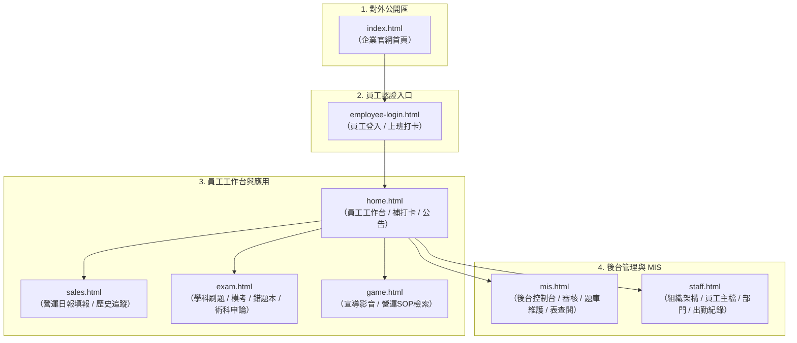

# 銀盾共同體 ERP 系統 ── 前端頁面架構與開發指引 (Frontend Pages Guide)

本文件全面盤點專案 [`page/`](file:///E:/0.Data_Doc/0.Doc/Github/erp_site/page) 目錄下所有前端 HTML 頁面，說明其核心功能、前後端資料交互、授權機制、UI 元件佈局與語意結構改善建議。

---

## 一、 前端頁面架構總覽

系統前端採用 **原生 HTML5 + ES Module + CSS Custom Properties** 架構，分為**「對外公開入口」**、**「員工內部工作台」**與**「MIS 後台管理」**三大層次：

---

## 二、 各 HTML 頁面詳細規格說明

### 1. `index.html` ── 官方企業入口網站 (Public Portal)
* **檔案路徑**：[`page/index.html`](file:///E:/0.Data_Doc/0.Doc/Github/erp_site/page/index.html)
* **對應腳本**：[`page/static/index.js`](file:///E:/0.Data_Doc/0.Doc/Github/erp_site/page/static/index.js)
* **訪問權限**：公開（無需登入）
* **核心功能**：
  * 企業形象展示、核心理念（OUR PHILOSOPHY）與四大產業據點（羅瓦德莊園、可可藝術沙龍、聯合工匠街、地下堅石礦場）。
  * 動態載入後端統計數據與公告（`/api/public`）。
  * 專業團隊介紹與依部門篩選公開成員（`/api/staff/public`、`/api/staff/departments`）。
  * 商務合作諮詢與實體營運據點地圖導航。
* **主要 API**：`GET /api/public`、`GET /api/staff/public`、`GET /api/staff/departments`。

---

### 2. `employee-login.html` ── 員工相關入口與快速打卡 (Employee Login)
* **檔案路徑**：[`page/employee-login.html`](file:///E:/0.Data_Doc/0.Doc/Github/erp_site/page/employee-login.html)
* **對應腳本**：[`page/static/employee-login.js`](file:///E:/0.Data_Doc/0.Doc/Github/erp_site/page/static/employee-login.js)
* **訪問權限**：公開 / 員工身分核對
* **核心功能**：
  * 即時時鐘與伺服器時間同步（`GET /api/time`）。
  * 員工編號輸入驗證（大寫英數）。
  * 支援雙模式進入：「**上班打卡並進入**（`CLOCK_IN`）」與「**不打卡進入系統**（`ACCESS_ONLY`）」。
* **主要 API**：`GET /api/time`、`POST /api/employee/login`。

---

### 3. `home.html` ── 員工工作台首頁 (Employee Dashboard)
* **檔案路徑**：[`page/home.html`](file:///E:/0.Data_Doc/0.Doc/Github/erp_site/page/home.html)
* **對應腳本**：[`page/static/home.js`](file:///E:/0.Data_Doc/0.Doc/Github/erp_site/page/static/home.js)
* **訪問權限**：需員工 Session（`silver_shield_employee`）
* **核心功能**：
  * 個人身分資訊（姓名、部門、職位、員工編號）歡迎橫幅。
  * 今日即時打卡狀態展示（已上班/已下班/尚未打卡）與補打卡（`makeupClock`）/ 下班打卡（`clockOutButton`）功能。
  * 常用功能快捷導航入口（營運日報、題庫練習、官方網站、宣導影音）。
* **主要 API**：`GET /api/employee/session`、`POST /api/attendance/clock`、`POST /api/employee/logout`。

---

### 4. `sales.html` ── 營運日報填報與審核追蹤 (Operations Reporting)
* **檔案路徑**：[`page/sales.html`](file:///E:/0.Data_Doc/0.Doc/Github/erp_site/page/sales.html)
* **對應腳本**：[`page/static/sales.js`](file:///E:/0.Data_Doc/0.Doc/Github/erp_site/page/static/sales.js)
* **訪問權限**：需員工 Session
* **核心功能**：
  * 新增營運日報表單（日期、據點區域、分類類別、數量、作業摘要備註）。
  * 日報個資防護提示與營運生命週期（`operations_process`）摘要。
  * 「我的填報與審閱回覆」列表：即時查看管理員審閱狀態（待審核、已核准、需補件），並支援在收到補件要求時直接回覆補充說明。
* **主要 API**：`GET /api/employee/session`、`GET /api/public`、`POST /api/operations/submit`、`POST /api/operations/reply`。

---

### 5. `exam.html` ── 題庫練習中心 (Training & Assessment)
* **檔案路徑**：[`page/exam.html`](file:///E:/0.Data_Doc/0.Doc/Github/erp_site/page/exam.html)
* **對應腳本**：[`page/static/exam.js`](file:///E:/0.Data_Doc/0.Doc/Github/erp_site/page/static/exam.js)
* **訪問權限**：需員工 Session
* **核心功能**：
  * **雙領域分頁**：
    1. **學科刷題 (`academic`)**：科目選單、題組自訂設定（題數/章節/題型篩選）、模擬考計時倒數、即時答案解析回饋、交卷評分。
    2. **術科申論 (`practical`)**：申論問答文字作答、送交 MIS 人工審核與審查意見回饋。
  * **錯題本管理**：自動收集答錯題目，提供手動移出错題本機制。
* **主要 API**：
  * `GET /api/training/catalog`、`POST /api/training/session/start`、`POST /api/training/session/answer`
  * `POST /api/training/session/submit`、`GET /api/training/wrong`、`POST /api/training/wrong/remove`
  * `GET /api/training/practical/questions`、`POST /api/training/practical/answer`。

---

### 6. `game.html` ── 企業宣導影音與 SOP 知識庫 (Media & SOP Library)
* **檔案路徑**：[`page/game.html`](file:///E:/0.Data_Doc/0.Doc/Github/erp_site/page/game.html)
* **對應腳本**：[`page/static/game.js`](file:///E:/0.Data_Doc/0.Doc/Github/erp_site/page/static/game.js)
* **訪問權限**：需員工 Session
* **核心功能**：
  * **宣導影音播放器**：支援解析 YouTube 各式網址（一般影片、Shorts、直播、分享連結），透過後端 API 安全解析 Video ID 並嵌入播放。
  * **SOP 文件檢索器**：即時搜尋企業營運 SOP 文件段落，具備分類篩選與閱讀器模態窗（Modal）。
* **主要 API**：`POST /api/youtube/resolve`、`GET /api/knowledge`、`GET /api/manuals`。

---

### 7. `staff.html` ── 員工主檔與出勤管理 (Staff Management & Attendance)
* **檔案路徑**：[`page/staff.html`](file:///E:/0.Data_Doc/0.Doc/Github/erp_site/page/staff.html)
* **對應腳本**：[`page/static/staff.js`](file:///E:/0.Data_Doc/0.Doc/Github/erp_site/page/static/staff.js)
* **訪問權限**：需管理員登入（`silver_shield_admin` Session）
* **核心功能**：
  * **三大多分頁**：
    1. **員工資料 (`staffPanel`)**：左側互動式組織架構樹（展開/摺疊/停用篩選）、中間員工清單與搜尋、右側員工詳細資料編輯表單與照片上傳（Base64 上傳、後端保存於 `static/staff/`）。
    2. **部門維護 (`departmentPanel`)**：新增與編輯部門主檔，防止誤停用仍有員工的部門。
    3. **打卡紀錄 (`attendancePanel`)**：依日期與員工編號查詢出缺勤打卡流水帳。
* **主要 API**：`POST /api/admin/login`、`GET /api/admin/staff`、`POST /api/admin/staff`、`POST /api/admin/departments`、`GET /api/admin/attendance`。

---

### 8. `mis.html` ── 後台管理資訊系統 (Admin Console & MIS)
* **檔案路徑**：[`page/mis.html`](file:///E:/0.Data_Doc/0.Doc/Github/erp_site/page/mis.html)
* **對應腳本**：[`page/static/mis.js`](file:///E:/0.Data_Doc/0.Doc/Github/erp_site/page/static/mis.js)
* **訪問權限**：需管理員登入
* **核心功能**：
  * **官方網站設定 (`settingsPanel`)**：修改前台主題色（銀盾藍/勳章紅/鋼鐵灰）、首頁主標題、副標題、即時公告，並提供即時效果預覽。
  * **待審佇列 (`queuePanel`)**：營運日報審核（核准/要求補件/退回）、回覆紀錄歷程。
  * **申論題審核 (`freeQuetionPanel`)**：批改員工術科申論答案並填寫回饋評語。
  * **SOP 文件與題庫同步 (`trainingPanel`)**：觸發 Word/Excel/PDF 轉檔同步、科目設定、章節維護。
  * **題庫維護 (`questionPanel`)**：題目草稿審核、題目啟用/停用/發布、批次修改。
  * **資料表查閱 (`dataPanel`)**：唯讀查閱系統 Company 資料表資料與分頁瀏覽。
* **主要 API**：`/api/admin/settings`、`/api/admin/submissions`、`/api/admin/compliance/*`、`/api/admin/manuals/*`、`/api/admin/table/*`。

---

## 三、 全域共通 UI 元件與設計規範

1. **左側導航側邊欄 (`.portal-sidebar`)**：
   * 在內部系統頁面（`home`、`sales`、`exam`、`game`、`staff`、`mis`）維持完全一致的選單結構與高亮樣式（`.active`）。
2. **頂部狀態欄 (`.portal-topbar`)**：
   * 包含系統麵包屑 / Kicker、頁面主標題與即時 API 連線指示燈（`#apiState`）。
3. **卡片式佈局 (`.portal-card` & `.portal-grid`)**：
   * 透過 CSS Grid 實現寬版 (`.wide`) 與側邊窄版 (`.narrow`) 的自適應分割。
4. **狀態回饋與無障礙 (`aria-live="polite"`)**：
   * 所有表單提交按鈕下方均配置 `aria-live="polite"` 的狀態提示段落，確保螢幕閱讀器與非同步請求的即時提示。

---

## 四、 跨頁面結構與品質優化發現 (Action Items)

| 頁面檔案 | 發現事項 | 建議修正方式 |
| :--- | :--- | :--- |
| **全數內部頁面** (`employee-login.html`、`exam.html`、`game.html`、`home.html`、`sales.html`) | `</body>` 標籤提早閉合於 `<footer>` 與 `<script>` 之前；且底部留有空的 `<footer></footer>`。 | 將 `</body>` 移至整份文件的最底部，並移除無內容的空 `<footer>`。 |
| **`index.html`** | `<h1>` 與 `` 標籤巢狀閉合語法錯誤；地圖 `iframe` 寬度固定 `1250px`。 | 修正標籤閉合；移除寫死寬度改為響應式 CSS 容器。 |
| **`home.html`** | 快捷入口卡片（第 85～91 行）內部包含空的 `` 且無內容。 | 補齊快捷項目或精簡移除多餘容器。 |
| **`staff.html` & `mis.html`** | 內嵌管理員登入表單直接置於頁面頂層，未登入時以整頁切換方式呈現。 | 保持目前設計，但可補上共用的 CSRF Token 初始化錯誤捕捉。 |
